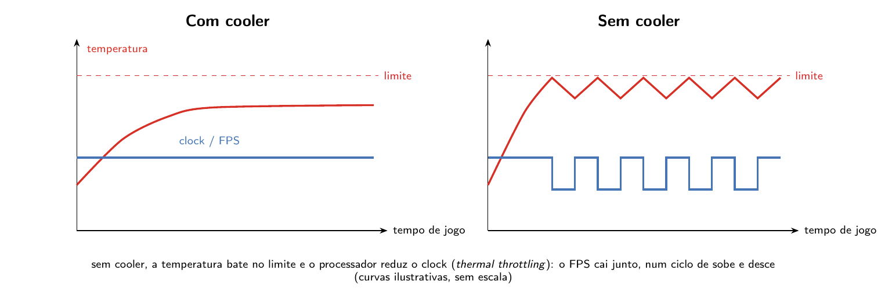
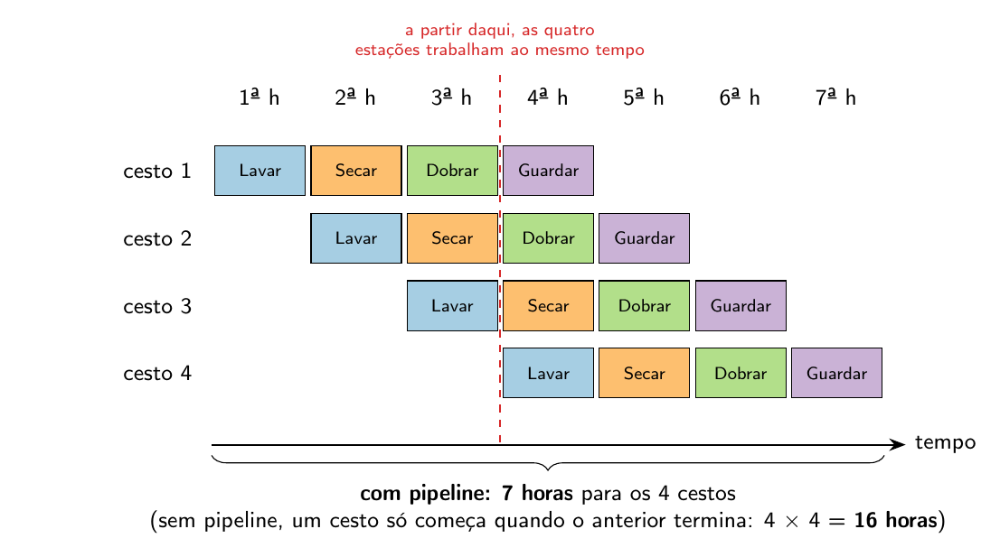

# Capítulo 4 — Processador: Organização Interna e Evolução

Neste capítulo você vai estudar a evolução histórica e os limites físicos do processador moderno — da lei de Moore ao problema do calor —, o peso da escolha entre RISC e CISC no mercado, a organização interna de um processador multicore (núcleos, threads, cache e pipeline), e os critérios de soquete, geração e compatibilidade que determinam a longevidade de uma plataforma no mercado. O Capítulo 13 dá sequência a este, aplicando esses conceitos a ferramentas concretas de benchmark e dimensionamento.

---

## 4.1 O processador como peça central da especificação

O Capítulo 3 tratou o processador do ponto de vista de quem programa para ele — a arquitetura. Este capítulo o trata do ponto de vista de quem especifica, monta e mantém computadores — a organização, na distinção da Seção 3.1. Dentro da tarefa de especificar uma máquina para uma determinada demanda, o processador (CPU, *Central Processing Unit*) ocupa posição crítica. A escolha da CPU não é uma decisão isolada: ela impõe restrições sobre a placa-mãe (via soquete e chipset) e sobre a fonte de alimentação (via potência exigida, tema do Capítulo 11), e é frequentemente o fator que define o desempenho final da máquina — o chamado **gargalo** (*bottleneck*) da especificação, tema retomado no Capítulo 13 (§13.4).

Se o processador fosse tratado como uma classe de programação, seus atributos característicos seriam:

- **Arquitetura** (x86/x64 ou ARM — e, com ela, o paradigma CISC ou RISC; Seção 4.2)
- **Litografia** (o processo de fabricação, tratado na Seção 4.3)
- **Fabricante**
- **Soquete** (o encaixe físico na placa-mãe, tratado na Seção 4.7)
- **Geração** (Seção 4.7)
- **Número de núcleos** (*cores*) e **memória cache** (Seção 4.5)
- **Número de threads** (Seção 4.5)
- **Potência** (em watts) e **clock** (frequência de trabalho), limitados pelo calor (Seção 4.4)

Esses atributos formam a "ficha técnica" completa de um processador, tal como aparece nos anúncios comerciais. O restante deste capítulo desenvolve cada um desses atributos; a metodologia de *benchmark*, que permite comparar processadores diferentes de forma objetiva, fica para o Capítulo 13.

[IMAGEM: anúncio real de processador com os atributos arquitetura, litografia, soquete, núcleos, threads, potência e clock destacados]

## 4.2 RISC e CISC no mercado: da irrelevância à decisão de compra

O Capítulo 3 (§3.3–3.6) tratou em profundidade a distinção entre os paradigmas CISC e RISC — retrocompatibilidade, famílias comerciais, eficiência energética. Esta seção não repete essa base: parte dela para mostrar como uma distinção que já foi irrelevante para o técnico de manutenção virou, nos últimos anos, uma decisão real de especificação.

Por muito tempo, essa escolha não chegava ao técnico de desktops e notebooks: processadores RISC ficavam restritos a smartphones, onde a eficiência energética é decisiva para a autonomia de bateria. Esse cenário mudou. Hoje, processadores RISC (como os chips Apple Silicon e os processadores Snapdragon) também competem no mercado de desktops e laptops. Consequentemente, ao especificar computadores portáteis — por exemplo, para uma equipe de professores que leva o equipamento para dar aula fora do laboratório —, a arquitetura passa a ser uma escolha técnica relevante: um notebook x86/x64 de alto desempenho pode exigir tantos acessórios de suporte (fonte robusta, ventilação adicional) que se torna impraticável para uso móvel, enquanto um equivalente ARM — de uma família historicamente otimizada para eficiência energética (Seção 3.5) — entrega autonomia de bateria muito superior. É a migração para ARM da Seção 3.7 chegando ao computador pessoal.

> **Atualidade de mercado — o chip ARM da NVIDIA para computação de IA local**
>
> Em 1º de junho de 2026, durante a feira Computex em Taipei, a NVIDIA — historicamente fabricante de placas de vídeo GeForce — anunciou o **RTX Spark**, um chip de arquitetura ARM (RISC) voltado a notebooks e desktops com Windows, com CPU desenvolvida em parceria com a MediaTek e memória unificada (nos moldes do que a Apple já pratica em seus chips Apple Silicon) e capacidade de até 128 GB de memória compartilhada entre CPU, GPU e NPU `[1]`. A NVIDIA e a Microsoft, em conjunto, descreveram o lançamento como parte de uma "reinvenção do computador".
>
> A novidade central não é a arquitetura ARM em si — a Qualcomm já vende chips ARM para Windows —, mas a proposta de uso: a plataforma, desenvolvida em conjunto com a Microsoft, foi pensada para executar localmente **agentes de inteligência artificial** (assistentes de programação e automação que operam diretamente na máquina do usuário, sem depender inteiramente de processamento em nuvem), apoiando-se na GPU integrada e na grande quantidade de memória unificada.
>
> O chip já nasce com parcerias fechadas com fabricantes de notebooks como Lenovo, HP, Dell, Asus, MSI e a própria Microsoft (linha Surface), colocando pressão competitiva simultânea sobre Intel, AMD, Qualcomm e Apple. Trata-se de uma notícia de mercado recente — o leitor deste livro deve tratá-la como indicativo de tendência, não como fato estático: a configuração exata de produtos comerciais baseados nesse chip deve ser verificada em fontes atualizadas no momento da leitura.

## 4.3 A Lei de Moore e os limites físicos da litografia

O primeiro atributo da lista da Seção 4.1 que depende diretamente da física é a litografia. Em 1965, Gordon Moore — que três anos depois cofundaria a Intel — observou que o número de transistores num circuito integrado dobrava a intervalos regulares; em 1975, ajustou esse intervalo para cerca de dois anos `[12]`. Essa observação empírica foi adotada como meta de desenvolvimento pela indústria e ficou conhecida como **lei de Moore**.

Como o transistor é a unidade fundamental de construção de portas lógicas, circuitos aritméticos, circuitos de controle e circuitos de memória (Capítulo 2, §2.2–2.4), um processador com o dobro de transistores tende a oferecer maior poder computacional. A @fig:transistores-tempo mostra esse crescimento ao longo de 45 anos.

![Transistores por chip de 1971 a 2016, em escala logarítmica. Dados: Wikipedia, “Transistor count” `[11]`.](imagens/transistores-tempo.png){#fig:transistores-tempo alt="Gráfico com o ano no eixo horizontal (1970 a 2020) e o número de transistores no eixo vertical, em escala logarítmica (mil, 1 milhão, 1 bilhão). Os pontos sobem quase em linha reta: Intel 4004 (1971, 2.250), 8086 (1978, 29.000), 80386 (1985, 275.000), 80486 (1989, cerca de 1,18 milhão), Pentium (1993, 3,1 milhões), Pentium 4 (2000, 42 milhões), Core 2 Duo (2006, 291 milhões) e Xeon Broadwell (2016, 7,2 bilhões)."}

Na @fig:transistores-tempo, como o eixo vertical é logarítmico (cada linha de grade vale mil vezes a anterior), dobrar a cada dois anos aparece como uma linha reta: em 45 anos, a contagem passou de 2.250 para 7,2 bilhões de transistores `[11]`.

O que permite colocar tantos transistores num chip é a redução da **litografia**, a escala em que os transistores são gravados, medida em nanômetros (nm) — para dar uma ideia, uma folha de papel tem cerca de 100.000 nm de espessura `[3]`. A tabela a seguir mostra a litografia de algumas famílias recentes:

| Fabricante/arquitetura | Litografia aproximada |
|---|---|
| Intel, 12ª geração | 10 nm |
| AMD Zen 3 (Ryzen série 5000) | 7 nm |
| AMD Zen 4 (Ryzen série 7000) | 5 nm |
| Apple Silicon (M1) | 5 nm |
| Qualcomm Snapdragon (gerações recentes) | ~3 nm |

*Dados de litografia levantados em 2026; a litografia real muda a cada nova geração de produto `[2]`. Nas gerações recentes, esses nomes ("7 nm", "5 nm", "Intel 7") tornaram-se rótulos comerciais do processo de fabricação e não correspondem mais a uma medida física exata do transistor.*

Reduzir a litografia traz dois benefícios simultâneos e vinculados: transistores menores ficam mais próximos uns dos outros e têm menos carga elétrica a mover a cada comutação — por isso comutam mais rápido (maior velocidade) e dissipam menos energia na forma de calor, por efeito Joule, a cada operação (maior eficiência energética). Um processador fabricado numa litografia menor tende, assim, a ser mais rápido e mais eficiente do que um equivalente fabricado numa litografia maior.

**O processo de fabricação.** O silício, elemento com quatro elétrons na camada de valência, é abundante — extraído da areia, não de jazidas raras — e forma cristais estáveis por ligação covalente entre átomos vizinhos. Após purificado e cristalizado, o silício é fatiado em discos finos chamados *wafers*. Sobre o *wafer*, um processo óptico de precisão chamado **litografia** projeta, com o auxílio de lasers e lentes especiais, a imagem do circuito do processador, "queimando" no silício o desenho dos transistores já interligados em portas lógicas. O processo de **dopagem** (introdução controlada de impurezas, como boro, na estrutura cristalina) cria as regiões de tipo N e tipo P que formam diodos e transistores (Capítulo 2, §2.2.2). Concluída a gravação, o *wafer* é fatiado em unidades individuais (os *dies*), que recebem encapsulamento protetor e se tornam o chip vendido no mercado, no formato que se conecta ao soquete da placa-mãe (Seção 4.7).

Historicamente, a Intel controlava tanto o projeto quanto a fabricação (fundição) de seus próprios chips. Outros fabricantes — AMD, Apple, Qualcomm — projetam seus chips mas terceirizam a fabricação para fundições especializadas, principalmente a TSMC (*Taiwan Semiconductor Manufacturing Company*), sediada em Taiwan. A dificuldade da Intel em reduzir sua própria litografia abaixo de 10 nm é um fator relevante da perda de competitividade da empresa nos últimos anos, a ponto de ela também ter passado a recorrer a fundições terceirizadas para parte de sua produção. A concentração geográfica dessa capacidade de fabricação de semicondutores de ponta em Taiwan é, adicionalmente, um fator de tensão geopolítica relevante, dado o contexto de disputa territorial entre Taiwan e a China — um ponto que tem desdobramentos diretos sobre preço e disponibilidade de chips no mercado global.

[IMAGEM: fotografia de um wafer de silício antes e depois do processo de litografia]

## 4.4 Calor, thermal throttling e o fim do núcleo único

Alocar mais transistores no mesmo espaço físico tem uma consequência inevitável: mais calor gerado na mesma área. Processadores das gerações mais antigas (até o início dos anos 2000) nem sempre possuíam proteção térmica — e a diferença entre ter ou não essa proteção podia ser dramática: um vídeo de demonstração histórico e amplamente citado (Tom's Hardware, ~2000–2001) comparou um Intel Pentium III e um AMD Athlon "Thunderbird", ambos sem *cooler*, sob carga. O Pentium III, equipado com um monitor térmico que desligava o processador ao atingir a temperatura crítica, travou o sistema mas sobreviveu; o Athlon, sem qualquer proteção térmica, literalmente queimou e soltou fumaça em menos de um segundo, chegando a 370 °C no núcleo `[4]`.

Os processadores modernos resolvem esse risco com o mecanismo de **thermal throttling** (acelerador térmico): ao detectar que a temperatura se aproxima de um limite pré-definido, o processador reduz automaticamente sua frequência de processamento; ao esfriar, ele volta a acelerar. O resultado é um ciclo contínuo de aceleração e desaceleração, governado pela temperatura.

O *thermal throttling* deixou de ser apenas uma medida de emergência e passou a ser usado como característica de projeto: um MacBook Air, que não tem ventoinha, reduz o clock progressivamente conforme aquece, enquanto um MacBook Pro com ventoinha ativa consegue sustentar clocks mais altos por mais tempo, adiando o momento do *throttling*. A @fig:throttling-cooler mostra esse ciclo.

{#fig:throttling-cooler alt="Dois gráficos lado a lado, com o tempo de jogo no eixo horizontal e uma linha tracejada marcando o limite de temperatura. Com cooler: a temperatura (vermelho) sobe e se estabiliza abaixo do limite, e o clock/FPS (azul) fica constante. Sem cooler: a temperatura bate no limite e passa a oscilar logo abaixo dele, e o clock/FPS cai e volta repetidamente, num sobe e desce."}

Na @fig:throttling-cooler, sem refrigeração suficiente, toda vez que a temperatura encosta no limite o processador reduz o clock, o FPS do jogo cai junto, e o ciclo se repete enquanto a carga durar. É por isso que a refrigeração (Capítulo 8, §8.5) e a pasta térmica (§8.6) entram no diagnóstico de desempenho, e não só no de superaquecimento.

**O limite que originou o multicore.** No início dos anos 2000, a Intel chegou a planejar um Pentium 4 de 4 GHz, mas cancelou o lançamento em outubro de 2004: a dissipação de calor necessária tornava o produto inviável para os computadores da época `[5]`. A solução encontrada pela indústria não foi continuar aumentando o clock e a complexidade de um único núcleo, mas **duplicar o número de núcleos de processamento** dentro do mesmo encapsulamento — cada um mais simples e mais frio do que seria um único núcleo hipertrofiado — a potência de um circuito cresce com o quadrado da tensão, e clocks mais altos exigem tensões mais altas (a equação aparece no Capítulo 5, §5.4). Nasceu assim a era **multicore** no mercado de desktop, por volta de 2005, com o lançamento do Pentium D pela Intel e do Athlon X2 pela AMD `[6]`. Essa mudança de rumo de projeto — uma decisão de organização, não de arquitetura (Seção 3.1) — se mantém até hoje: não houve retorno ao núcleo único, apenas a adição de novas unidades de processamento especializadas (GPU, NPU), apresentadas no Capítulo 1 (§1.11.1).

## 4.5 A era multicore: núcleos, cache e hyper-threading

Um **core** (núcleo) é uma unidade de processamento física — hardware. Um processador multicore contém, dentro de um único encapsulamento, múltiplas cópias completas da estrutura de processamento (unidade lógico-aritmética, registradores, unidades de controle de fluxo), cada uma com sua própria memória cache de nível 1 (L1) e nível 2 (L2). Externamente aos núcleos, mas ainda dentro do chip, fica a cache de nível 3 (L3), compartilhada entre todos os núcleos — funcionando como uma mesa de trabalho comum para a troca de dados entre eles quando uma tarefa é dividida entre múltiplos núcleos. São os níveis de cache da pirâmide de memória do Capítulo 1 (§1.10.3), detalhados no Capítulo 5 (§5.8).

O número de núcleos também ajuda a entender a segmentação de mercado vista na Seção 3.1 (i3, i5, i7). Nem todo processador de uma mesma linha de produção nasce igual: após a fabricação, cada chip passa por uma bancada de testes, num processo chamado *binning* `[7]`. Às vezes, um chip com todos os núcleos aprovados é vendido como a linha superior (por exemplo, um "i7"), enquanto um chip do mesmo *die*, com núcleos defeituosos desabilitados, é vendido como produto de linha inferior ("i5" ou "i3"). Nas gerações mais recentes, porém, as linhas inferiores costumam vir de *dies* fisicamente menores e diferentes.

Uma **thread**, por sua vez, é uma unidade lógica: um núcleo físico mantém, em hardware, mais de um conjunto de registradores de estado e, por isso, é enxergado pelo sistema operacional como mais de um processador — embora esses processadores lógicos compartilhem as mesmas unidades de execução. A tecnologia responsável por isso é chamada de **hyper-threading** (nomenclatura da Intel) ou **SMT**, *simultaneous multi-threading* (termo genérico, também usado pela AMD). Um núcleo físico com hyper-threading de grau 2 é enxergado pelo sistema operacional como dois processadores lógicos.

**Exemplo.** Um anúncio real de processador Intel Core i5-12400F (12ª geração) especifica 6 núcleos físicos (*cores*) com hyper-threading, totalizando 12 threads `[8]` — ou seja, o sistema operacional identifica 12 processadores lógicos disponíveis, embora fisicamente existam apenas 6.

Essa complexidade, no entanto, tem um custo que sobe para as camadas de software: programação paralela (a técnica de dividir um algoritmo para ser executado simultaneamente em múltiplos núcleos) é uma disciplina distinta e mais difícil do que a programação sequencial convencional, e a maioria dos programas aplicativos comuns não é otimizada para tirar proveito de mais do que quatro a seis núcleos simultâneos. A consequência prática desse descompasso — poder computacional disponível, mas ocioso — é discutida no Capítulo 13 (§13.4).

[IMAGEM: fotografia (die shot) de um processador com quatro núcleos, cache L1/L2 por núcleo e cache L3 compartilhada identificados]

## 4.6 Pipeline: sobreposição de estágios de execução

Além de multiplicar núcleos, há outra forma de extrair mais trabalho do mesmo hardware: evitar que partes dele fiquem paradas. O ciclo básico de funcionamento de uma CPU — coordenado pela unidade de controle da arquitetura de von Neumann (Capítulo 2, §2.6) — consiste em três etapas repetidas continuamente: **busca** da instrução na memória, **decodificação** dessa instrução e **execução** da instrução decodificada. A técnica de **pipeline** consiste em sobrepor essas etapas para diferentes instruções simultaneamente, em vez de executar o ciclo completo de uma instrução antes de iniciar a próxima.

**Analogia (adaptada da clássica analogia da lavanderia de Patterson & Hennessy `[9]`).** Considere uma lavanderia com quatro estações — lavar, secar, dobrar e guardar —, em que cada etapa leva uma hora. Numa execução sem pipeline, o ciclo completo (lavar → secar → dobrar → guardar) leva 4 horas, e o próximo ciclo só começa depois que o anterior termina inteiramente: quatro ciclos completos consumiriam 16 horas (4 etapas × 1 hora × 4 ciclos), com cada máquina ficando ociosa na maior parte do tempo. Com pipeline, assim que a máquina de lavar termina uma carga e a transfere para a secadora, ela já recebe uma nova carga de roupa suja — nenhum equipamento fica parado. Nesse esquema, em sete horas obtêm-se quatro ciclos completos de saída, contra as dezesseis horas necessárias sem sobreposição — um ganho de mais do que o dobro de produtividade utilizando exatamente o mesmo hardware, apenas evitando ociosidade.

Uma lógica parecida — aproveitar partes do circuito que ficariam ociosas — está por trás do hyper-threading (Seção 4.5): quando as instruções de uma thread deixam unidades de execução paradas — por exemplo, esperando dados da memória, o gargalo de von Neumann do Capítulo 2 (§2.7) —, o núcleo as ocupa com instruções de outra thread. O termo *pipeline* não é exclusivo da arquitetura de computadores — é usado de forma equivalente em engenharia de produção industrial para descrever qualquer processo organizado em estágios reaproveitáveis e encadeados.

{#fig:pipeline-lavanderia alt="Grade com as horas de 1 a 7 nas colunas e os cestos de 1 a 4 nas linhas. Cada cesto passa por quatro etapas coloridas — lavar (azul), secar (laranja), dobrar (verde) e guardar (roxo) —, e cada cesto começa uma hora depois do anterior, em escada. Uma linha tracejada vermelha na 4ª hora marca o momento em que as quatro estações trabalham ao mesmo tempo. Embaixo: com pipeline, 7 horas para os 4 cestos; sem pipeline, 4 × 4 = 16 horas."}

Na @fig:pipeline-lavanderia, cada cesto continua levando 4 horas, mas, a partir da 4ª hora, as quatro estações trabalham ao mesmo tempo, cada uma num cesto diferente. É assim que o pipeline do processador sobrepõe busca, decodificação e execução de instruções diferentes: nenhuma instrução fica mais rápida, mas o conjunto termina muito antes.

## 4.7 Soquete, geração e compatibilidade de mercado

O último atributo da lista da Seção 4.1 é o encaixe do processador na placa-mãe. O Capítulo 8 (§8.4) trata o soquete do ponto de vista físico — o conector, a compatibilidade entre fabricante e geração, as diferenças entre os soquetes Intel e AMD. Esta seção antecipa a mesma compatibilidade sob a ótica de mercado: o impacto que a estratégia de soquete de cada fabricante tem sobre a longevidade de uma plataforma e sobre a recomendação de compra ao cliente.

Historicamente, a AMD tem mantido o mesmo soquete por múltiplas gerações de processador — o soquete AM4 atendeu várias gerações consecutivas de Ryzen, e o soquete AM5, lançado mais recentemente, teve seu suporte estendido pela AMD até o ano de 2029 `[10]`. Isso significa que uma placa-mãe AM5 fabricada hoje tende a continuar aceitando processadores lançados anos depois — em geral, mediante uma atualização de BIOS (Capítulo 8, §8.4.1). A Intel, por sua vez, tende a alterar o soquete a cada uma ou duas gerações.

**Consequência prática para o técnico.** Diante de uma placa-mãe com defeito comprovado, cujo processador continua funcional, a estratégia de diagnóstico modular da Seção 1.6.2 (transferir o processador para outra placa-mãe compatível) é significativamente mais viável em um ecossistema AMD — em que placas-mãe compatíveis com processadores mais antigos continuam disponíveis no mercado — do que em um ecossistema Intel, no qual encontrar uma placa-mãe compatível com um processador de poucos anos atrás pode ser difícil e caro o suficiente para tornar mais econômico descartar o processador funcional e comprar um conjunto novo (processador e placa-mãe).

Esse tipo de escolha de projeto — que reduz a vida útil economicamente viável de um componente ainda funcional — se aproxima do fenômeno mais amplo de **obsolescência programada**, observável em outras indústrias. Do ponto de vista puramente técnico, isso reforça por que a análise de soquete e longevidade de plataforma deve fazer parte da recomendação de compra ao cliente, e não apenas a comparação de desempenho bruto — que é tratada, com apoio de benchmark, no Capítulo 13. Cabe notar, entretanto, que a Intel frequentemente compensa essa desvantagem de longevidade praticando preços mais agressivos, de modo que a escolha entre os dois fabricantes é sempre uma decisão de custo-benefício, não uma resposta única.

[IMAGEM: foto comparativa de soquete AMD (AM4/AM5) e soquete Intel (LGA) com os pinos/contatos visíveis]

---

## Síntese do capítulo

Este capítulo apresentou o processador como peça central da tarefa de especificação de um computador: o peso da escolha entre RISC e CISC no mercado, os limites físicos impostos pela litografia e pelo calor — e a mudança de rumo que esse limite provocou, do núcleo único ao multicore —, a organização interna de um processador multicore (núcleos, threads, cache e pipeline) e os critérios de soquete, geração e compatibilidade que determinam a longevidade de uma plataforma no mercado. O Capítulo 13 dá sequência direta a este, aplicando esses mesmos atributos — arquitetura, litografia, núcleos, soquete — à metodologia concreta de benchmark que permite compará-los de forma objetiva e dimensionar um computador dentro de um orçamento. Antes disso, a cache volta no Capítulo 5 (§5.8), a refrigeração e o soquete físico no Capítulo 8 (§8.4–8.6), e a potência do processador no dimensionamento da fonte, no Capítulo 11.

---

## Referências

1. NVIDIA NEWSROOM/GEFORCE NEWS. "NVIDIA at COMPUTEX 2026: NVIDIA RTX Spark..." Disponível em: <https://www.nvidia.com/en-us/geforce/news/computex-2026-nvidia-geforce-rtx-announcements/>; TOM'S HARDWARE. "Nvidia unveils RTX Spark Superchip for laptops and desktop PCs at Computex 2026." Disponível em: <https://www.tomshardware.com/laptops/nvidia-unveils-rtx-spark-superchip-at-computex-2026-new-platform-promises-to-turn-windows-into-an-agentic-ai-os-with-arm-cpu-blackwell-gpu-and-128gb-unified-memory>.
2. Dados de litografia por fabricante/arquitetura conferidos via TechInsights/TrendForce/roteiro de nós de processo TSMC; cobertura em notebookcheck.net e techpowerup.com.
3. NATIONAL INSTITUTE OF STANDARDS AND TECHNOLOGY (NIST). "A sheet of paper is about 100,000 nanometers thick." Disponível em: <https://x.com/NIST/status/1792590000179064919>; NATIONAL NANOTECHNOLOGY INITIATIVE. "Just How Small Is Nano?" Disponível em: <https://www.nano.gov/about-nanotechnology/just-how-small-is-nano/>.
4. TOM'S HARDWARE. "Hot Spot: How Modern Processors Cope With Heat Emergencies." Disponível em: <https://www.tomshardware.com/reviews/hot-spot,365-4.html>.
5. CHANNEL INSIDER. "Intel Cancels 4-GHz Pentium 4." Disponível em: <https://www.channelinsider.com/news-and-trends/intel-cancels-4-ghz-pentium-4/>; PC PERSPECTIVE. "Intel Cancels the 4GHz Prescott." Disponível em: <https://pcper.com/2004/10/intel-cancels-the-4ghz-prescott/>.
6. INTEL NEWSROOM. "Dual Core Era Begins, PC Makers Start Selling Intel-Based PCs." 18 abr. 2005. Disponível em: <https://www.intel.com/pressroom/archive/releases/2005/20050418comp.htm>.
7. Documentação técnica geral sobre segmentação de produto e *binning* de CPUs (Intel/AMD); artigos técnicos sobre *yield* de semicondutores — fonte específica a confirmar pelo autor.
8. INTEL. Especificações oficiais, "Intel® Core™ i5-12400F Processor (18M Cache, up to 4.40 GHz)." Disponível em: <https://www.intel.com/content/www/us/en/products/sku/134587/intel-core-i512400f-processor-18m-cache-up-to-4-40-ghz/specifications.html>.
9. PATTERSON, David A.; HENNESSY, John L. *Computer Organization and Design: The Hardware/Software Interface* — RISC-V Edition. Cambridge, MA: Morgan Kaufmann, 2017. ISBN 978-0-12-812275-4.
10. TECHPOWERUP. "AMD Announces Socket AM5 Longevity till 2029." Disponível em: <https://www.techpowerup.com/349541/amd-announces-socket-am5-longevity-till-2029>; VIDEOCARDZ. Disponível em: <https://videocardz.com/newz/amd-extends-am5-socket-support-through-2029-with-future-ryzen-cpus>.
11. WIKIPEDIA. "Transistor count." Disponível em: <https://en.wikipedia.org/wiki/Transistor_count>.
12. MOORE, Gordon E. "Cramming more components onto integrated circuits." *Electronics*, v. 38, n. 8, abr. 1965; MOORE, Gordon E. "Progress in digital integrated electronics." *IEEE International Electron Devices Meeting*, 1975.
